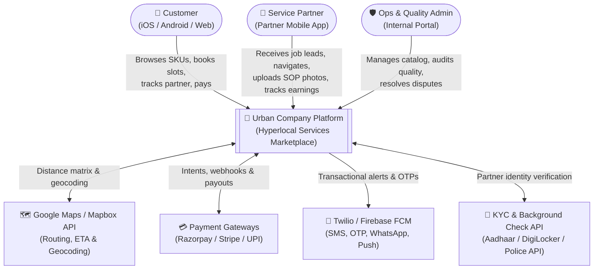
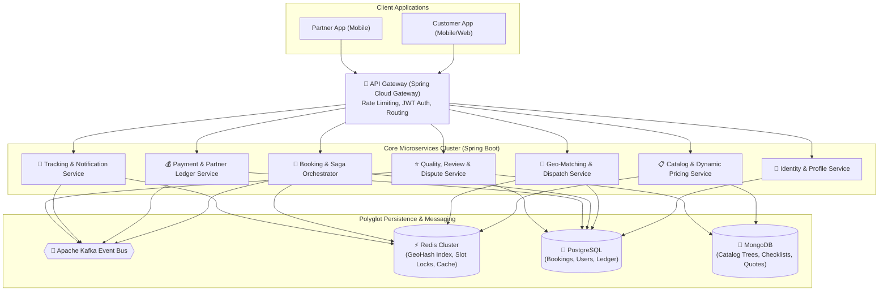
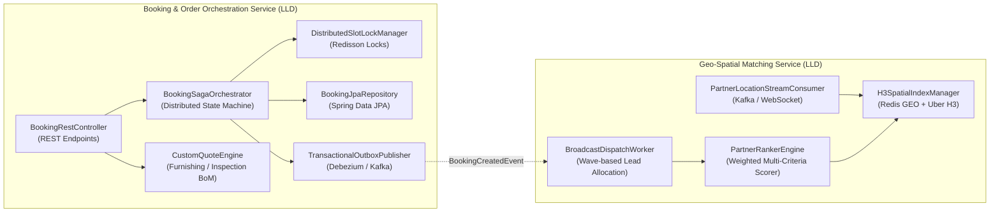
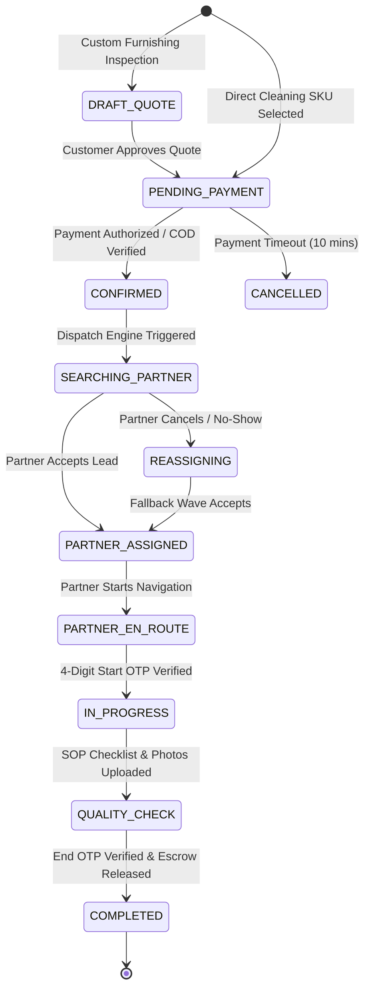
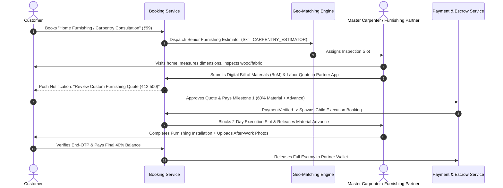

# 🏠 Urban Company Platform — Enterprise Microservices Architecture & System Design

[](https://openjdk.org/)
[](https://spring.io/projects/spring-boot)
[](https://spring.io/projects/spring-cloud)
[](https://kafka.apache.org/)
[](https://redis.io/)
[](#)

A hyperlocal, on-demand home services marketplace platform modeled after **Urban Company**. This system connects millions of customers with background-verified, trained service professionals across domains such as **Home Deep Cleaning, Carpentry & Home Furnishing, Appliance Repair, Plumbing, Salon & Spa at Home, and Painting**.

---

## 📑 Table of Contents
1. [Domain Overview: How Urban Company Works](#1-domain-overview-how-urban-company-works)
2. [High-Level Design (HLD) & Low-Level Design (LLD) via The C4 Model](#2-high-level-design-hld--low-level-design-lld-via-the-c4-model)
   - [Level 1: System Context Diagram (HLD)](#level-1-system-context-diagram-hld)
   - [Level 2: Container Diagram (HLD)](#level-2-container-diagram-hld)
   - [Level 3: Component Diagram (LLD)](#level-3-component-diagram-lld)
   - [Level 4: Code & Database Schema Level (LLD)](#level-4-code--database-schema-level-lld)
3. [Deep-Dive Microservices Analysis (6-Parameter Matrix)](#3-deep-dive-microservices-analysis-6-parameter-matrix)
   - [3.1 API Gateway & Edge Service](#31-api-gateway--edge-service)
   - [3.2 Identity & User/Partner Profile Service](#32-identity--userpartner-profile-service)
   - [3.3 Service Catalog & Dynamic Pricing Service](#33-service-catalog--dynamic-pricing-service)
   - [3.4 Geo-Spatial Discovery & Partner Matching Service](#34-geo-spatial-discovery--partner-matching-service)
   - [3.5 Booking & Order Orchestration Service](#35-booking--order-orchestration-service)
   - [3.6 Payment, Escrow & Partner Ledger Service](#36-payment-escrow--partner-ledger-service)
   - [3.7 Real-Time Tracking & Notification Service](#37-real-time-tracking--notification-service)
   - [3.8 Quality Assurance, Ratings & Dispute Service](#38-quality-assurance-ratings--dispute-service)
4. [End-to-End Platform Workflows](#4-end-to-end-platform-workflows)
   - [4.1 Home Cleaning & Standardized Service Flow](#41-home-cleaning--standardized-service-flow)
   - [4.2 Home Furnishing, Carpentry & Custom Inspection Flow](#42-home-furnishing-carpentry--custom-inspection-flow)
5. [Design Patterns Used in the Project](#5-design-patterns-used-in-the-project)
   - [5.1 Core Java / Object-Oriented Design Patterns](#51-core-java--object-oriented-design-patterns)
   - [5.2 Distributed Microservices Design Patterns](#52-distributed-microservices-design-patterns)
6. [Getting Started & Local Deployment](#6-getting-started--local-deployment)

---

## 1. Domain Overview: How Urban Company Works

Unlike traditional classifieds (which merely share phone numbers) or standard e-commerce (which ships physical goods), a **managed home-services marketplace** orchestrates real-world human labor inside a customer's private residence. The platform solves four core operational challenges:

1. **Service Standardization (SKU-ization of Labor):**
   - **Fixed-Scope Services (e.g., 2BHK Deep Home Cleaning, Sofa Shampooing, AC Foam-Jet Service):** Broken down into deterministic SKUs with fixed durations, standardized checklists (e.g., *Kitchen Degreasing -> Bathroom Acid-Free Descaling -> Living Room Vacuuming*), fixed chemical/equipment kits, and upfront dynamic pricing.
   - **Inspection-Driven / Custom Services (e.g., Custom Home Furnishing, Modular Wardrobe Repair, Full Home Painting):** Begins with a low-cost or free **Consultation/Inspection SKU**. A senior technician visits the home, takes laser measurements, generates a digital **Bill of Materials (BoM) & Custom Quote** on their Partner App, and once the customer approves and pays the milestone deposit in-app, the execution booking is spawned.
2. **Hyperlocal Supply-Demand Matching (Spatial + Temporal + Skill):**
   - Matching is not merely "nearest partner." The engine evaluates:
     - **Geofence & H3 Hexagonal Grid Proximity** (travel time < 25 mins).
     - **Skill & Certification Matrix** (e.g., a cleaner certified for *Marble Polishing* vs. *Basic Sweeping*).
     - **Equipment & Inventory Readiness** (does the partner carry an industrial wet-and-dry vacuum cleaner?).
     - **Calendar Slot Availability** (accounting for service duration + travel buffer).
3. **Trust, Safety & SOP Enforcement:**
   - Mandatory KYC, police verification, and in-app training modules before a partner goes `ONLINE`.
   - **4-Digit Start/End OTPs** to verify physical arrival and prevent billing fraud.
   - **Before & After Photo Proof** uploaded via the Partner App for quality audits (e.g., before/after pictures of a cleaned chimney or assembled furnishing unit).
4. **Split Settlement & Escrow Accounting:**
   - Customer funds are held in escrow until job completion. Upon `JOB_COMPLETED`, the platform automatically deducts commission/platform fees, taxes (GST), and micro-insurance, crediting the net payout to the partner's withdrawable wallet.

---

## 2. High-Level Design (HLD) & Low-Level Design (LLD) via The C4 Model

The **C4 Model** provides hierarchical zoom levels into the software architecture, moving from business context down to code implementation.

### Level 1: System Context Diagram (HLD)
Shows how the **Urban Company Platform** interacts with external actors (Customers, Service Partners, Operations Admins) and third-party external systems.



---

### Level 2: Container Diagram (HLD)
Zooms into the **Urban Company Platform** to show the deployable microservices, API Gateway, databases, caches, and asynchronous event bus.



---

### Level 3: Component Diagram (LLD)
Zooms inside the **Booking & Order Orchestration Service** and **Geo-Spatial Matching Service** to illustrate internal Spring Boot beans, domain engines, and external adapters.



---

### Level 4: Code & Database Schema Level (LLD)
Represents the low-level entity relationships, state machine transitions, and key Java class contracts.

#### Booking Lifecycle State Machine


#### Core Relational & Document Schema Design
* **PostgreSQL (`bookings` table):**
  * `booking_id` (UUID, PK), `customer_id` (UUID, FK), `partner_id` (UUID, FK, Nullable), `service_category` (ENUM: `HOME_CLEANING`, `HOME_FURNISHING`, `APPLIANCE`, `SALON`), `booking_type` (ENUM: `STANDARD_SKU`, `INSPECTION_QUOTE`), `status` (VARCHAR), `scheduled_start` (TIMESTAMPTZ), `scheduled_end` (TIMESTAMPTZ), `start_otp` (VARCHAR(4)), `end_otp` (VARCHAR(4)), `total_amount` (DECIMAL(10,2)), `version` (BIGINT — Optimistic Locking).
* **PostgreSQL (`ledger_entries` table — Double-Entry Bookkeeping):**
  * `entry_id` (UUID, PK), `transaction_id` (UUID), `account_id` (UUID — Customer Escrow / Partner Wallet / Platform Revenue / Tax), `entry_type` (ENUM: `DEBIT`, `CREDIT`), `amount` (DECIMAL(10,2)), `created_at` (TIMESTAMPTZ).
* **MongoDB (`service_catalog` collection):**
  * Dynamic nested JSON supporting variable room sizes (1BHK, 2BHK, Villa), add-ons (Balcony Cleaning, Sofa Vacuuming), required tools, SOP checklist steps, and dynamic pricing rules.

---

## 3. Deep-Dive Microservices Analysis (6-Parameter Matrix)

Below is the comprehensive architectural specification for all **8 core microservices** across the 6 required operational and engineering dimensions.

---

### 3.1 API Gateway & Edge Service
* **1. Primary Purpose & Key Responsibilities:**
  * Serves as the single entry point for Customer, Partner, and Admin clients.
  * Handles TLS termination, JWT validation, OAuth2 token introspection, request routing, dynamic rate limiting (per user/IP), API versioning, and cross-cutting observability (Correlation ID / Trace ID injection).
* **2. Measuring Success (KPIs):**
  * Gateway routing overhead latency: **$p_{99} < 8\text{ ms}$**.
  * Edge availability: **$99.99\%$**.
  * Rate-limit accuracy: $100\%$ mitigation of abusive traffic bursts without dropping legitimate booking requests.
* **3. Data Flow, Response Times & Failure Impact:**
  * **Flow:** `Client -> WAF/CDN -> Spring Cloud Gateway -> Redis (Rate Limit & Token Blacklist Check) -> Downstream Microservice`.
  * **Response Time:** $3\text{ ms} - 8\text{ ms}$ overhead added to downstream calls.
  * **Failure Impact:** **Critical (Severity-1).** If the Gateway goes down, all external mobile/web traffic is severed. Mitigated via multi-AZ auto-scaling and health-checked DNS failover.
* **4. Technologies, Advantages & Limitations:**
  * **Tech Stack:** Spring Cloud Gateway (Netty non-blocking event loop), Redis (Token Bucket rate limiter), Resilience4j Circuit Breaker.
  * **Advantages:** High concurrency with low memory footprint due to reactive Netty architecture; centralizes security concerns.
  * **Limitations:** Reactive WebFlux debugging stack traces are complex; heavy custom payload transformations inside the gateway can degrade throughput.
* **5. Scalability & Performance Targets:**
  * Stateless horizontal scaling behind an AWS ALB / Nginx ingress.
  * Target throughput: **$25,000\text{ requests/sec}$** during peak weekend morning surges (8:00 AM – 11:00 AM).
* **6. Security, Reliability & Compliance:**
  * Enforces TLS 1.3, CORS policies, OWASP header hardening, and JWT RS256 signature verification.
  * Circuit breakers isolate failing downstream services (e.g., if Reviews Service slows down, Booking routes remain unaffected).

---

### 3.2 Identity & User/Partner Profile Service
* **1. Primary Purpose & Key Responsibilities:**
  * Manages authentication (OTP-based passwordless login for customers/partners), Role-Based Access Control (RBAC), customer saved addresses, and comprehensive **Partner Onboarding Workflows** (KYC document verification, skill certifications, police clearance status, and equipment kit ownership).
* **2. Measuring Success (KPIs):**
  * OTP login verification latency: **$p_{95} < 150\text{ ms}$**.
  * Partner KYC onboarding turnaround time (automated checks): **$< 2\text{ minutes}$**.
  * Unauthorized access incidents: **$0$**.
* **3. Data Flow, Response Times & Failure Impact:**
  * **Flow:** `Client -> Auth Service -> Redis (OTP TTL Store) / PostgreSQL (User & Partner Profiles) -> External KYC API -> Kafka (PartnerVerifiedEvent)`.
  * **Response Time:** $40\text{ ms} - 120\text{ ms}$.
  * **Failure Impact:** **High.** New logins and partner profile updates halt; however, existing authenticated sessions continue working until JWT expiry (15–30 mins).
* **4. Technologies, Advantages & Limitations:**
  * **Tech Stack:** Spring Security, OAuth2 / JWT, PostgreSQL, Redis, AWS S3 (encrypted KYC document storage).
  * **Advantages:** Strong ACID guarantees for partner compliance status; fast OTP verification via Redis.
  * **Limitations:** Third-party government/KYC APIs can experience high latency or downtime, requiring async webhook callbacks.
* **5. Scalability & Performance Targets:**
  * Read-heavy (profile & skill lookups during dispatch). Cached in Redis with a 10-minute TTL, achieving **$15,000\text{ reads/sec}$**.
* **6. Security, Reliability & Compliance:**
  * PII (Aadhaar/SSN, phone numbers, home addresses) encrypted at rest using **AES-256-GCM** and masked in logs.
  * Strict GDPR / DPDP Act compliance for data erasure and consent auditing.

---

### 3.3 Service Catalog & Dynamic Pricing Service
* **1. Primary Purpose & Key Responsibilities:**
  * Manages the hierarchical service taxonomy (`Category -> Sub-Category -> Service SKU -> Add-ons`), standardized SOP checklists (e.g., 45-point Deep Home Cleaning checklist), material requirements, and **Dynamic Surge & Locality Pricing** based on real-time supply-demand ratios, apartment size (1BHK–5BHK), and time-of-day demand.
* **2. Measuring Success (KPIs):**
  * Catalog browse API latency: **$p_{99} < 35\text{ ms}$**.
  * Cart-to-checkout conversion rate lift via dynamic pricing: **$+12\%$**.
  * Price calculation accuracy: **$100\%$** parity between cart preview and checkout lock.
* **3. Data Flow, Response Times & Failure Impact:**
  * **Flow:** `Customer App -> Catalog Service -> Redis Cache -> MongoDB (Catalog Documents) + Surge Rule Engine`.
  * **Response Time:** $15\text{ ms} - 35\text{ ms}$ (cache hit); $80\text{ ms}$ (cache miss).
  * **Failure Impact:** **High.** Customers cannot browse services or configure home cleaning/furnishing packages. Mitigated via multi-tier caching (Caffeine L1 + Redis L2) so stale catalog reads still succeed during DB maintenance.
* **4. Technologies, Advantages & Limitations:**
  * **Tech Stack:** Spring Boot, MongoDB (flexible schema for diverse service attributes), Redis, Caffeine in-memory cache.
  * **Advantages:** MongoDB natively models deeply nested service variants (e.g., *Wood Polishing -> Matte vs. Glossy -> Sq. Ft. tiers*) without complex SQL joins.
  * **Limitations:** Eventual consistency when admins update base prices across distributed caches (requires Kafka cache-invalidation events).
* **5. Scalability & Performance Targets:**
  * **99:1 Read-to-Write ratio.** Handles **$40,000\text{ reads/sec}$** at $< 30\text{ ms}$ latency via edge and Redis caching.
* **6. Security, Reliability & Compliance:**
  * Generates cryptographically signed **Price Quote Tokens (JWT/HMAC)** valid for 15 minutes so malicious clients cannot tamper with SKU prices during checkout.

---

### 3.4 Geo-Spatial Discovery & Partner Matching Service
* **1. Primary Purpose & Key Responsibilities:**
  * The core intelligence engine of the platform. Ingests real-time GPS heartbeats from active partners every 5 seconds, indexes them into spatial grids, checks slot availability, and runs a **Multi-Criteria Partner Ranking & Wave Dispatch Algorithm** to assign the optimal technician for a booking.
* **2. Measuring Success (KPIs):**
  * Partner assignment rate within 3 minutes of booking: **$> 96\%$**.
  * Average partner travel time to customer home: **$< 22\text{ minutes}$**.
  * GPS heartbeat ingestion latency: **$p_{99} < 20\text{ ms}$**.
* **3. Data Flow, Response Times & Failure Impact:**
  * **Flow:**
    * *Write Path:* `Partner App (GPS every 5s) -> WebSocket/Gateway -> Kafka (partner-location) -> Redis GEOADD & H3 Index`.
    * *Match Path:* `BookingCreatedEvent -> Geo-Matching Service -> Query Redis GEO (5km radius) -> Filter by Skill, Equipment & Calendar -> Score & Broadcast Push Notification in Waves`.
  * **Response Time:** $< 150\text{ ms}$ to compute ranked candidate list.
  * **Failure Impact:** **Critical.** Bookings remain stuck in `SEARCHING_PARTNER` state. Automated fallback switches from real-time GPS to partner's registered "Home Hub Pincode" if Redis Geo lags.
* **4. Technologies, Advantages & Limitations:**
  * **Tech Stack:** Redis Geospatial (`GEOADD`/`GEORADIUS`), Uber H3 Hexagonal Spatial Index, Apache Kafka, Spring Boot.
  * **Advantages:** Sub-millisecond spatial radius queries in Redis; H3 hexagons eliminate edge distortion when calculating demand-supply heatmaps.
  * **Limitations:** High memory consumption in Redis if location history is retained (solved by storing only latest coordinates in Redis and streaming historical tracks to cold storage).
* **5. Scalability & Performance Targets:**
  * Sustains **$50,000\text{ GPS updates/sec}$** across 100,000+ active partners concurrently.
  * Executes **$2,000\text{ complex matching queries/sec}$**.
* **6. Security, Reliability & Compliance:**
  * Partner exact coordinates are obfuscated (jittered within 200m) on the Customer App until the partner enters `EN_ROUTE` status to protect partner privacy.

---

### 3.5 Booking & Order Orchestration Service
* **1. Primary Purpose & Key Responsibilities:**
  * Manages the end-to-end lifecycle of a service order—from slot reservation and distributed concurrency locking (preventing double-booking a partner or time slot) to managing **Inspection-to-Quote workflows** (for carpentry/furnishing), rescheduling, cancellations, and OTP verification.
* **2. Measuring Success (KPIs):**
  * Double-booking collision rate: **$0.00\%$**.
  * Booking creation latency: **$p_{95} < 250\text{ ms}$**.
  * Order completion rate (non-cancelled): **$> 91\%$**.
* **3. Data Flow, Response Times & Failure Impact:**
  * **Flow:** `Checkout Request -> Acquire Redisson Lock (slot + partner/zone) -> Verify Price Signature -> Persist Booking (PostgreSQL) + Outbox Event -> Release Lock -> Trigger Payment & Dispatch Sagas`.
  * **Response Time:** $120\text{ ms} - 250\text{ ms}$.
  * **Failure Impact:** **Critical.** Directly impacts revenue generation. Uses the **Transactional Outbox Pattern** so database commits and Kafka event emissions never go out of sync.
* **4. Technologies, Advantages & Limitations:**
  * **Tech Stack:** Spring Boot, Spring StateMachine, PostgreSQL (with Optimistic Locking `@Version`), Redisson (Distributed Locks), Debezium CDC.
  * **Advantages:** Deterministic state transitions prevent illegal jumps (e.g., marking a job `COMPLETED` without `START_OTP` verification).
  * **Limitations:** Saga rollback compensations (e.g., refunding wallet credits when no partner is found) add state complexity.
* **5. Scalability & Performance Targets:**
  * Database partitioned by `city_id` and `scheduled_date`.
  * Handles **$3,500\text{ concurrent bookings/sec}$** during festival cleaning rushes (e.g., Diwali/New Year).
* **6. Security, Reliability & Compliance:**
  * Idempotency keys (`X-Idempotency-Key`) required on all booking creation and cancellation endpoints to prevent duplicate charges on flaky mobile networks.

---

### 3.6 Payment, Escrow & Partner Ledger Service
* **1. Primary Purpose & Key Responsibilities:**
  * Handles customer payments (UPI, Cards, Wallets, Pay-After-Service), holds funds in **Escrow**, calculates **Custom Furnishing Material Milestones**, executes split settlements (Platform Commission + GST + Partner Payout), and maintains an immutable **Double-Entry Accounting Ledger**.
* **2. Measuring Success (KPIs):**
  * Payment authorization success rate: **$> 98.5\%$**.
  * Ledger reconciliation discrepancy: **$0.00$** (100% balanced debits/credits).
  * Partner instant payout settlement time: **$< 30\text{ seconds}$** post-job completion.
* **3. Data Flow, Response Times & Failure Impact:**
  * **Flow:** `Booking Confirmed -> Payment Intent (Razorpay/Stripe) -> Webhook Callback -> Escrow Credit -> Job Completed Event -> Split Calculation Engine -> Double-Entry Ledger Commit -> Partner Wallet Credit`.
  * **Response Time:** $200\text{ ms} - 500\text{ ms}$ (dependent on external payment gateway).
  * **Failure Impact:** **High.** If online payment gateway fails, seamlessly degrades to "Pay via UPI QR on Completion" mode so bookings are not lost.
* **4. Technologies, Advantages & Limitations:**
  * **Tech Stack:** Spring Boot, PostgreSQL (`SERIALIZABLE` isolation for ledger transactions), Apache Kafka, Razorpay/Stripe SDKs.
  * **Advantages:** Immutable append-only ledger guarantees complete financial auditability and tax compliance.
  * **Limitations:** High lock contention on hot accounts (e.g., Platform Revenue Account) if not sharded into sub-ledger buckets.
* **5. Scalability & Performance Targets:**
  * **$1,500\text{ financial transactions/sec}$** with zero data loss (`acks=all` in Kafka, synchronous DB replication).
* **6. Security, Reliability & Compliance:**
  * **PCI-DSS Compliant** (zero raw card data stored; uses tokenized payment instruments).
  * Webhook HMAC-SHA256 signature verification and replay-attack prevention.

---

### 3.7 Real-Time Tracking & Notification Service
* **1. Primary Purpose & Key Responsibilities:**
  * Delivers live partner turn-by-turn ETA tracking on the customer's map, manages masked VoIP call bridging (so neither party sees the other's real phone number), and orchestrates omnichannel notifications (Push via FCM/APNs, SMS, WhatsApp, Email).
* **2. Measuring Success (KPIs):**
  * Push notification delivery latency: **$p_{95} < 1.5\text{ seconds}$**.
  * Live tracking WebSocket frame drop rate: **$< 0.5\%$**.
  * Lead broadcast delivery rate to partners: **$99.9\%$**.
* **3. Data Flow, Response Times & Failure Impact:**
  * **Flow:** `Kafka Domain Events (Assigned, EnRoute, OTP, Completed) -> Notification Template Engine -> User Preference Filter -> FCM / Twilio / WebSocket Push`.
  * **Response Time:** $< 50\text{ ms}$ internal processing; $< 1.5\text{ s}$ end-to-end delivery.
  * **Failure Impact:** **Medium-High.** Core booking still exists, but partners may miss job alerts if push fails—mitigated by automatic fallback from Push Notification to Automated IVR Voice Call if a partner doesn't acknowledge a lead within 15 seconds.
* **4. Technologies, Advantages & Limitations:**
  * **Tech Stack:** Spring WebSocket (STOMP), Netty, Apache Kafka, Firebase Cloud Messaging (FCM), Twilio/Exotel APIs.
  * **Advantages:** Event-driven decoupling allows adding new channels (e.g., WhatsApp live tracking) without modifying upstream services.
  * **Limitations:** Maintaining hundreds of thousands of persistent WebSocket connections requires sticky sessions or Redis Pub/Sub fan-out across nodes.
* **5. Scalability & Performance Targets:**
  * **$200,000\text{ concurrent WebSocket connections}$** and **$10,000\text{ notifications/sec}$**.
* **6. Security, Reliability & Compliance:**
  * Virtual number masking via Twilio/Exotel proxy sessions that automatically expire 2 hours after job completion.

---

### 3.8 Quality Assurance, Ratings & Dispute Service
* **1. Primary Purpose & Key Responsibilities:**
  * Enforces service quality via **Mandatory Before/After Photo Verification** (using computer vision/ML checks for blur or irrelevant images), processes 5-star customer reviews, computes rolling partner quality scores (which directly feed into the Geo-Matching ranker), and manages rework/refund claims.
* **2. Measuring Success (KPIs):**
  * Review submission rate: **$> 45\%$** of completed bookings.
  * Photo SOP compliance rate: **$> 98\%$**.
  * Dispute resolution SLA: **$< 4\text{ hours}$**.
* **3. Data Flow, Response Times & Failure Impact:**
  * **Flow:** `Partner Uploads Before/After Photos -> Pre-Signed S3 URL -> Quality Service (ML Validation) -> Unlock End-OTP -> Customer Submits Rating -> Kafka (PartnerRatingUpdatedEvent) -> Updates Geo-Matching Ranker`.
  * **Response Time:** $80\text{ ms}$ for rating submission; $500\text{ ms}$ for async image validation.
  * **Failure Impact:** **Low-Medium.** If image ML validation times out, fails-open to allow job completion while flagging the photos for asynchronous human ops audit.
* **4. Technologies, Advantages & Limitations:**
  * **Tech Stack:** Spring Boot, MongoDB (unstructured review tags, photo metadata, audit trails), PostgreSQL (aggregated partner ratings), AWS S3.
  * **Advantages:** Directly closes the feedback loop—low-rated partners automatically receive fewer high-value leads and get routed to retraining modules.
  * **Limitations:** Susceptible to review bombing or fake reviews without verified-booking constraints.
* **5. Scalability & Performance Targets:**
  * **$5,000\text{ review/audit reads/sec}$** and **$1,000\text{ media uploads/min}$** via direct S3 pre-signed URLs (bypassing app server bandwidth).
* **6. Security, Reliability & Compliance:**
  * Exif metadata stripping and PII/face blurring on uploaded home interior photos to safeguard customer home privacy.

---

## 4. End-to-End Platform Workflows

### 4.1 Home Cleaning & Standardized Service Flow
How the platform discovers, matches, and executes a fixed-scope service (e.g., **"2BHK Full Home Deep Cleaning + Kitchen Chimney Degreasing"**):

1. **Discovery & Dynamic Configuration:**
   - Customer opens the app; GPS resolves their H3 spatial cell (e.g., *Hitech City, Hyderabad*).
   - `Catalog Service` loads localized packages. Customer selects **2BHK Deep Cleaning** (Estimated Duration: `240 mins`, Required Crew: `2 Partners`, Equipment: `Industrial Vacuum, Steam Sanitizer, Eco-Safe Chemicals`).
   - `Dynamic Pricing Engine` checks the H3 cell's real-time utilization. Since demand is normal, base price (`₹3,499`) is locked into a signed `QuoteToken`.
2. **Slot Reservation & Payment:**
   - Customer selects `Tomorrow, 09:00 AM`.
   - `Booking Service` acquires a distributed lock on the time slot, creates the order in `PENDING_PAYMENT`, and processes UPI payment via `Payment Service` into **Escrow**.
3. **Hyperlocal Partner Matching (Wave Dispatch):**
   - `BookingConfirmedEvent` triggers the `Geo-Matching Service`.
   - **Step A (Spatial Filter):** Queries Redis `GEORADIUS` for partners within `5 km` of the customer's apartment.
   - **Step B (Capability & Inventory Filter):** Filters for partners with `SKILL_DEEP_CLEANING`, `RATING >= 4.6`, `EQUIPMENT_STEAM_CLEANER = TRUE`, and an open `4-hour` calendar block.
   - **Step C (Multi-Criteria Scoring):** Ranks candidates using:
     $$\text{Score} = (0.35 \times \text{Proximity}) + (0.30 \times \text{Rating}) + (0.20 \times \text{AcceptanceRate}) + (0.15 \times \text{LowUtilizationBonus})$$
   - **Step D (Wave Broadcast):** Sends high-priority push notifications to the top 3 ranked partners (Wave 1). The first partner (or two-person team) to swipe **Accept** wins the distributed lock.
4. **In-Home Execution & SOP Verification:**
   - **Arrival:** Partner arrives at 08:55 AM, enters the customer's **4-Digit Start OTP** (`4821`), transitioning booking to `IN_PROGRESS`.
   - **Checklist & Proof:** Partner completes room-by-room SOP tasks in the Partner App and uploads **Before & After photos** of the kitchen chimney and washrooms.
   - **Completion:** Customer inspects the home and shares the **4-Digit End OTP** (`9104`).
5. **Escrow Release & Rating:**
   - `Payment Service` splits `₹3,499`: credits `₹2,799` to Partner Wallet, `₹550` to Platform Revenue, and `₹150` to GST/Insurance ledger accounts. Customer rates the crew 5 stars.

---

### 4.2 Home Furnishing, Carpentry & Custom Inspection Flow
Unlike fixed-price home cleaning, **Home Furnishing & Carpentry** (e.g., *Custom Wardrobe Partitioning, Sofa Upholstery Re-padding, Curtain Rod & Blinds Installation, Modular Kitchen Hinge Overhaul*) involves unknown dimensions and material costs. The platform manages this via a **Two-Phase Inspection-to-Execution Workflow**:



1. **Phase 1 — Consultation & Measurement SKU:**
   - Customer books a **Home Furnishing Consultation** (`₹99`, adjustable against final bill).
   - `Geo-Matching Service` dispatches a **Senior Estimator / Master Carpenter** equipped with laser measurement tools and fabric/laminate sample catalogs.
2. **Phase 2 — Digital Bill of Materials (BoM) Generation:**
   - Inside the home, the partner uses the Partner App's **Quote Builder** to select standardized rate-card items (e.g., *18mm BWP Marine Ply @ ₹220/sq.ft*, *Soft-Close Hydraulic Hinges x 6*, *2 Days Carpentry Labor*).
   - This prevents arbitrary overcharging while allowing infinite customization.
3. **Phase 3 — Customer Approval & Milestone Escrow:**
   - Customer receives an itemized digital quote in-app, approves it, and pays Milestone 1.
   - `Booking Service` automatically converts the `DRAFT_QUOTE` into an execution order, reserves multi-day calendar slots for the carpenter (plus an assistant helper if heavy lifting is required), and tracks warranty coverage (e.g., *6-Month Urban Company Furnishing Warranty*).

---

## 5. Design Patterns Used in the Project

### 5.1 Core Java / Object-Oriented Design Patterns

| Design Pattern | Category | Where It Is Applied in the Codebase | Engineering Rationale |
| :--- | :--- | :--- | :--- |
| **Strategy Pattern** | Behavioral | `PricingStrategy` (`StandardPricingStrategy`, `PeakSurgePricingStrategy`, `MembershipDiscountStrategy`) & `PartnerScoringStrategy` | Allows swapping pricing rules and partner-matching weights dynamically at runtime based on city, category (Cleaning vs. Furnishing), or demand surge without modifying core service logic. |
| **State Pattern** | Behavioral | `BookingState` (`PendingPaymentState`, `ConfirmedState`, `SearchingPartnerState`, `InProgressState`, `CompletedState`) | Encapsulates valid transitions and side effects for each booking status, eliminating sprawling `if-else` blocks and preventing illegal state transitions. |
| **Factory Method & Abstract Factory** | Creational | `ServiceWorkflowFactory` (`StandardSkuWorkflowFactory` vs. `InspectionQuoteWorkflowFactory`) | Instantiates the appropriate validation rules, checklist templates, and billing flows depending on whether a service is fixed-scope (Cleaning) or inspection-driven (Furnishing). |
| **Builder Pattern** | Creational | `CustomFurnishingQuote.Builder`, `BookingResponseDTO.Builder`, `PartnerSearchCriteria.Builder` | Cleanly constructs complex, immutable domain objects with numerous optional parameters (e.g., add-ons, coupon codes, room dimensions, equipment filters). |
| **Observer / Event Listener Pattern** | Behavioral | Spring `ApplicationEventPublisher` & `@TransactionalEventListener` | Decouples core transaction commits (e.g., booking completion) from secondary side effects (e.g., updating partner metrics, triggering invoice PDF generation). |
| **Decorator Pattern** | Structural | `ServicePriceCalculator` wrapped by `GstTaxDecorator`, `SafetyInsuranceFeeDecorator`, `PromoDiscountDecorator` | Dynamically layers taxes, platform safety fees, and promotional discounts onto base SKU prices cleanly and transparently. |
| **Template Method Pattern** | Behavioral | `AbstractNotificationDispatcher` (`preparePayload() -> checkUserPreferences() -> sendViaProvider() -> logDelivery()`) | Enforces a uniform notification pipeline while letting subclasses (`PushDispatcher`, `SmsDispatcher`, `WhatsAppDispatcher`) implement provider-specific delivery. |

---

### 5.2 Distributed Microservices Design Patterns

| Microservice Pattern | Implementation in Platform | Problem Solved |
| :--- | :--- | :--- |
| **API Gateway / Backend for Frontend (BFF)** | Spring Cloud Gateway with tailored response payloads for Customer App vs. Partner App | Prevents chatty client-to-microservice calls over mobile networks and centralizes auth, SSL, and rate limiting. |
| **Saga Pattern (Choreography + Orchestration)** | Kafka-driven Choreography for Booking $\rightarrow$ Payment $\rightarrow$ Dispatch $\rightarrow$ Notification, with compensating transactions on failure | Maintains data consistency across distributed databases without fragile two-phase commits (2PC). |
| **Transactional Outbox & CDC** | Outbox table in PostgreSQL read by Debezium into Apache Kafka | Guarantees **at-least-once** event publishing; eliminates the dual-write problem where a DB commit succeeds but Kafka publish fails. |
| **CQRS (Command Query Responsibility Segregation)** | Write models in normalized PostgreSQL; Read models denormalized into MongoDB & Redis | Optimizes high-throughput catalog browsing and live partner tracking independently from transactional booking writes. |
| **Circuit Breaker, Bulkhead & Retry** | Resilience4j annotations on external Payment, Maps, and KYC calls | Prevents cascading failures when third-party gateways degrade, isolating thread pools per downstream dependency. |
| **Distributed Locking** | Redisson (`RLock`) keyed by `slot:{zoneId}:{date}:{hour}` and `booking:{bookingId}:accept` | Guarantees strict mutual exclusion so two customers never book the last slot and two partners never claim the same job lead. |
| **Database-per-Service (Polyglot Persistence)** | PostgreSQL (ACID bookings/ledger), MongoDB (Catalog/Quotes), Redis (Geo/Cache) | Ensures loose coupling between microservices and aligns each service with the storage engine best suited to its access pattern. |
| **Idempotent Consumer Pattern** | `processed_events` deduplication table & `X-Idempotency-Key` headers | Ensures retried Kafka messages or duplicate payment webhooks never double-charge customers or double-credit partner wallets. |

---

## 6. Getting Started & Local Deployment

### Prerequisites
* **Java 17+** & **Maven 3.9+**
* **Docker & Docker Compose** (for PostgreSQL, MongoDB, Redis, Kafka, and Zookeeper)

### Quick Start
```bash
# 1. Clone the repository
git clone https://github.com/coder-stat920715/urban-company-platform.git
cd urban-company-platform

# 2. Spin up infrastructure containers (Kafka, Redis, PostgreSQL, MongoDB)
docker-compose up -d

# 3. Build all microservices
mvn clean install -DskipTests

# 4. Start core services (Service Registry, API Gateway, Booking, Geo, Catalog, Payment)
docker-compose -f docker-compose.services.yml up -d
```

### API Documentation
Once running locally, interactive OpenAPI / Swagger documentation is accessible via the Gateway at:
* **Aggregated Swagger UI:** `http://localhost:8080/swagger-ui.html`
* **Health & Metrics (Actuator):** `http://localhost:8080/actuator/health`