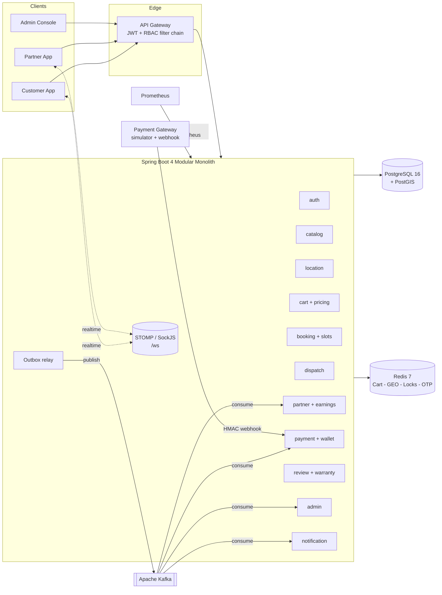
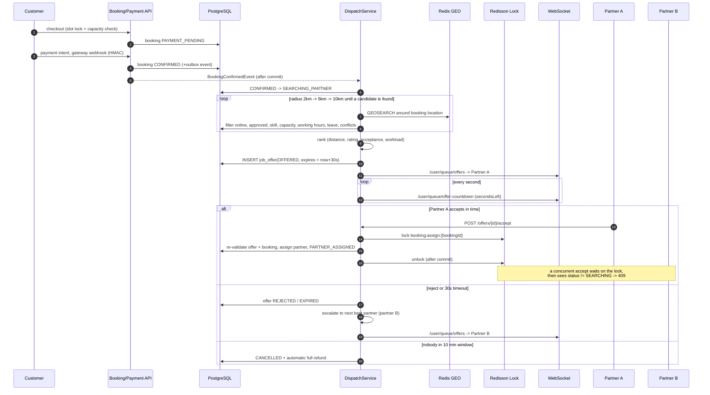
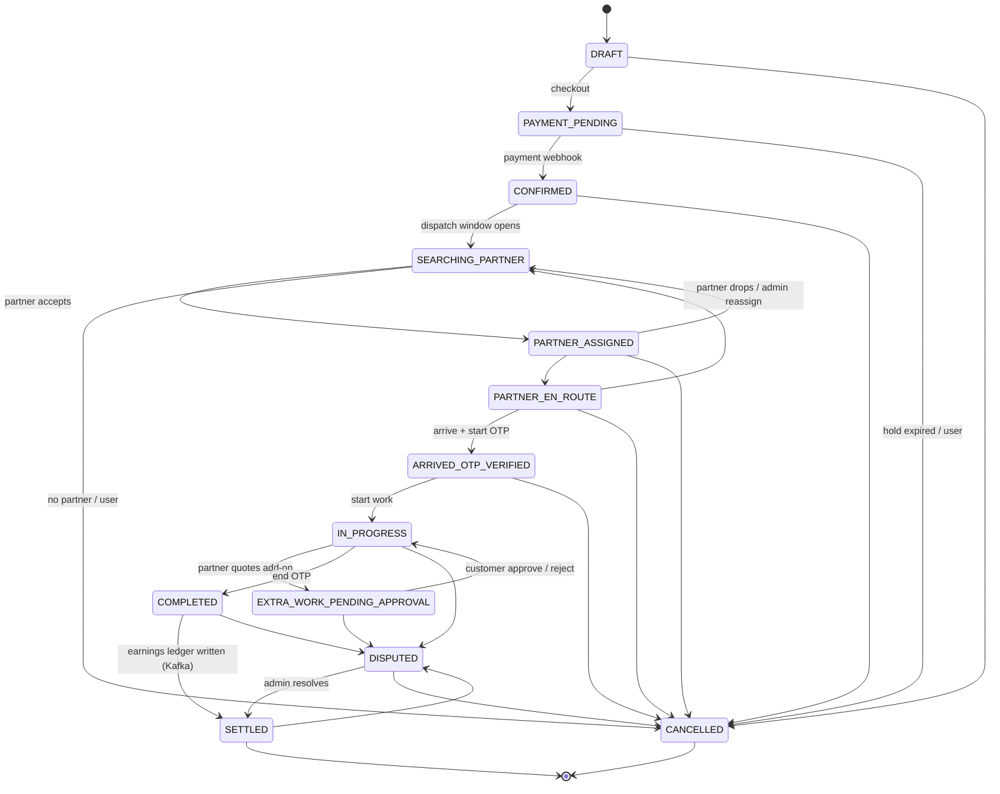
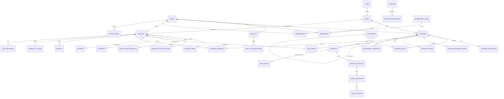

# Urban Company Platform — Architecture (HLD + LLD)

Java 21 · Spring Boot 4.1.2 · PostgreSQL 16 + PostGIS · Redis 7 (cache, GEO, locks) · Apache Kafka · STOMP/SockJS WebSocket

---

## 1. High-Level Design

### 1.1 Architecture style
A **Clean, Domain-Driven Modular Monolith**. Each business capability is a top-level package that owns its entities, repositories, services and controllers:

`auth · catalog · location · cart · booking · dispatch · partner · payment · review · admin · notification` (+ `common`, `config`).

Rules that keep every module extractable into a microservice with near-zero friction:

1. Modules talk through **service classes and domain events only** (no cross-module repository writes, no shared mutable entities).
2. Cross-module data is referenced by **id** (`customer_id`, `partner_id`, `category_id` …), never by JPA associations.
3. Side effects that other modules react to are **events**: Spring in-process events (synchronous, same transaction) for refund/dispatch hooks, and **Kafka events via the Transactional Outbox** for everything asynchronous (notifications, earnings, cashback, audit).
4. The **API Gateway pattern** is realised by a single Spring Security filter chain (JWT, RBAC by URL prefix `/api/v1/admin/**`, `/api/v1/partner/**`) in front of all controllers; when modules are split, this chain moves to a gateway (Spring Cloud Gateway / Envoy) unchanged.

### 1.2 System context & infrastructure topology



### 1.3 Real-time partner matching & auto-dispatch



Double-assignment is prevented in three layers: (1) **Redisson lock** `lock:booking:assign:{id}` serialising accept/expire/reassign; (2) **state check** inside the transaction (`status == SEARCHING_PARTNER && partner_id IS NULL`); (3) **optimistic locking** `@Version` on `bookings` as the final DB-level backstop.

### 1.4 Booking lifecycle (State pattern)



### 1.5 Entity-relationship diagram



### 1.6 Non-functional & scalability design

| Concern | Design |
|---|---|
| **Geospatial indexing** | Online partners are kept in Redis (`GEOADD geo:partners:online`). Dispatch uses `GEOSEARCH` with radius expansion **2 → 5 → 10 km**. A per-partner heartbeat key (`partner:hb:{id}`, 30 s TTL, refreshed by the 5-second GPS ping) evicts stale/offline positions at read time. PostGIS stores generated `geography(Point)` columns + GiST indexes on zones/addresses for ad-hoc geo analytics. |
| **Geofencing** | A location is serviceable if inside an active zone's polygon (ray-casting) or radius (haversine). Used on address creation and checkout. |
| **Slot reservation** | `lock:slot:{zone}:{category}:{date}` (Redisson) serialises capacity re-check + booking insert, so two customers can never take the last partner slot. Unpaid bookings hold capacity for 15 min. |
| **Job acceptance** | `lock:booking:assign:{id}` + status guard + `@Version` (see §1.3). |
| **Money** | Wallet rows use `@Version` optimistic locking; every movement is a ledger row. A concurrent writer gets HTTP 409 `CONCURRENT_UPDATE`. Coupon redemption uses a conditional `UPDATE … WHERE used_count < usage_limit`. |
| **Transactional Outbox** | Domain events are inserted into `outbox_events` in the **same DB transaction** as the state change. `OutboxRelay` polls with `FOR UPDATE SKIP LOCKED` (safe with N instances), publishes to Kafka (`acks=all`, idempotent producer) and marks rows `SENT`. Delivery is at-least-once; consumers are idempotent (`partner_earnings.booking_id UNIQUE`, wallet reference check, `payment_events.event_id UNIQUE`). |
| **Kafka topics** | `uc.booking-events`, `uc.dispatch-events`, `uc.payment-events`, `uc.earnings-events`, `uc.partner-events` — keyed by aggregate id (per-booking ordering). Consumers: Notification, Earnings ledger (+settlement), Cashback, Audit. |
| **Observability** | Actuator (`/actuator/health` with liveness/readiness, `/actuator/prometheus`), Micrometer metrics, Micrometer Tracing bridge to OpenTelemetry (trace/span ids in every log line; add `opentelemetry-exporter-otlp` + `management.otlp.tracing.endpoint` to export), **structured JSON logging** (`logging.structured.format.console=ecs`). |
| **Stateless scale-out** | No HTTP sessions; JWT access (15 min) + refresh (7 d, rotated, stored in Redis). Schedulers are multi-instance safe (SKIP LOCKED, Redisson locks). |
| **Security** | BCrypt passwords, HS256 JWT, RBAC (`ROLE_CUSTOMER/PARTNER/ADMIN`), OTP rate-limit + lockout, HMAC-SHA256 webhook signatures (constant-time compare), STOMP CONNECT authentication and per-booking SUBSCRIBE authorisation. |

---

## 2. Low-Level Design

### 2.1 Database
Flyway: `V1__init_schema.sql` (≈40 tables, FKs, composite/partial-purpose indexes, `JSONB` package attributes with GIN index, PostGIS generated geography columns with GiST indexes, audit timestamps) and `V2__seed_data.sql` (Bengaluru city + 3 zones, 3-level catalog, packages, add-on questions/options, spare-part rate cards, commission tiers, surge rules, coupons, UC Plus plans). `DemoDataSeeder` creates the admin and demo customer/partners at startup.

### 2.2 Design patterns (explicit)

| Pattern | Where |
|---|---|
| **State** | `BookingStatus` (legal-next map) + `BookingStateMachine` (actor guards, history rows, outbox event on every transition). |
| **Strategy – pricing** | `PricingStrategy` implementations ordered by `@Order`: `SurgePricingStrategy(10)` → `InstantSurchargeStrategy(15)` → `MembershipDiscountStrategy(20)` → `CouponPricingStrategy(30)` → `ConvenienceFeeStrategy(40)` → `TaxPricingStrategy(50)`, executed by `PricingEngine`. Adding a rule = adding a bean. |
| **Strategy – dispatch ranking** | `PartnerScoringStrategy` / `WeightedPartnerScoring`: `0.4·(1−dist/radius) + 0.3·rating/5 + 0.2·acceptance + 0.1·(1−load)` (weights in `application.yml`). |
| **Factory / Builder** | `PackageAssembler` assembles `PackageDetail` (Lombok `@Builder`) from package + dynamic add-on questions/options. |
| **Transactional Outbox** | `DomainEventPublisher` (MANDATORY propagation) + `OutboxRelay`. |
| **Observer / Event-driven** | Spring events (`BookingConfirmedEvent`, `BookingCancelledEvent`, `BookingRefundEvent`) and Kafka consumers. |
| **Repository, Service Layer, DTO records** | Throughout. |

### 2.3 Pricing formula
```
subtotal      = Σ (base + Σ option deltas) × qty            (recomputed from catalog on every read)
surge         = subtotal × (max matching rule multiplier − 1) + instant surcharge
membership    = subtotal × plan% ; convenience fee waived for UC Plus
coupon        = min(discount, subtotal + surge − membership)     (PERCENT/FLAT, caps, per-user & global limits)
taxable       = subtotal + surge − membership − coupon + convenience fee
total         = taxable + GST(18 %)
partner gross = subtotal + surge + approved extra work
commission    = gross × tier %   (Standard 25 → Platinum 18, by jobs completed) ; TDS = gross × 1 %
```

### 2.4 Cancellation policy
Free before a partner is assigned or > 2 h before start; 10 % of total inside 2 h; 25 % (min ₹100) once the partner is en route/on site. Admin can override the fee (`cancellationFee`, 0 = waive). Refunds go to the wallet for the wallet-funded share and are recorded as a processed gateway refund for the rest.

### 2.5 REST API summary (full interactive spec: Swagger UI `/swagger-ui.html`, OpenAPI 3.1 JSON `/v3/api-docs`)

| Area | Endpoints |
|---|---|
| **Auth** | `POST /api/v1/auth/otp/request`, `/otp/verify`, `/register`, `/login`, `/refresh`, `/logout`, `GET /me` |
| **Catalog (public)** | `GET /api/v1/catalog/categories`, `/categories/{id}/services`, `/services/{id}`, `/packages/{id}` |
| **Location** | `GET /api/v1/locations/cities`, `/serviceability?lat&lng`; `GET/POST/PUT/DELETE /api/v1/addresses` |
| **Cart** | `GET/DELETE /api/v1/cart`, `POST /cart/items`, `PUT/DELETE /cart/items/{lineId}`, `POST /cart/quote` |
| **Booking** | `GET /bookings/slots`, `POST /bookings/checkout`, `GET /bookings`, `GET /bookings/{id}`, `POST /bookings/{id}/cancel`, `POST /bookings/{id}/extra-work/{reqId}`, `POST /bookings/{id}/dispute`, `GET/POST /bookings/{id}/chat` |
| **Payment** | `POST /payments/intents`, `POST /payments/webhook` (HMAC), `POST /payments/simulate/{intentId}`, `GET /wallet`, `/wallet/transactions`, `GET /membership/plans`, `GET /membership`, `POST /membership/subscribe` |
| **Review / warranty** | `POST /reviews`, `GET /reviews/partner/{id}`, `POST/GET /warranty/claims` |
| **Notifications** | `GET /notifications`, `POST /notifications/read-all` |
| **Partner** | `POST/PUT/GET /partner/profile`, `POST /partner/documents`, `POST /partner/kyc/submit`, `PUT /partner/availability`, `POST /partner/location`, `PUT/GET /partner/working-hours`, `POST/GET/DELETE /partner/leaves`, `GET /partner/offers`, `POST /partner/offers/{id}/accept\|reject`, `GET /partner/jobs`, `POST /partner/jobs/{id}/en-route\|arrive\|verify-start-otp\|start\|extra-work\|complete\|release`, `GET /partner/earnings/summary\|history\|tds-summary`, `POST/GET /partner/withdrawals` |
| **Admin** | `/admin/catalog/*` (CRUD categories, services, packages, questions, options, rate-cards), `/admin/locations/*` (cities, zones – radius or polygon), `/admin/partners/*` (list, scorecard, KYC review, approve/reject/suspend/reinstate, withdrawals), `/admin/pricing/*` (surge rules, coupons, commission tiers, UC Plus plans), `/admin/bookings/*` (list, reassign, cancel with fee override, refund, resolve-dispute), `/admin/warranty-claims/*`, `/admin/wallet-credit`, `/admin/reports/*` (summary, bookings-daily, top-partners, audit) |

All responses use the envelope `{ "success", "code", "message", "data", "timestamp" }`. Errors: `400` validation, `401/403` auth, `404`, `409` state/concurrency conflict, `422` business-rule violation (stable machine-readable `code`, e.g. `SLOT_UNAVAILABLE`, `MULTI_CATEGORY_CART`, `OTP_INVALID`).

### 2.6 WebSocket contract (STOMP over SockJS, endpoint `/ws`)

Connect with header `Authorization: Bearer <accessToken>` in the STOMP `CONNECT` frame.

| Direction | Destination | Payload |
|---|---|---|
| Server → partner | `/user/queue/offers` | `{offerId, bookingId, distanceKm, scheduledStart, durationMinutes, estimatedGross, expiresAt, ttlSeconds}` |
| Server → partner | `/user/queue/offer-countdown` | `{offerId, bookingId, secondsLeft}` (1 Hz) |
| Server → any user | `/user/queue/notifications` | `{id, title, body}` |
| Server → booking parties | `/topic/bookings/{id}/location` | `{partnerId, lat, lng, heading, speedKmph, ts}` (live GPS) |
| Server → booking parties | `/topic/bookings/{id}/status` | `{bookingId, status, from, at}` |
| Server → booking parties | `/topic/bookings/{id}/extra-work` | add-on quote / decision |
| Both ways | `/topic/bookings/{id}/chat` (send to `/app/chat/{id}`) | `{id, senderId, content, sentAt}` |
| Partner → server | `/app/partner/heartbeat` | `{lat, lng, heading?, speedKmph?}` every ~5 s (REST fallback `POST /api/v1/partner/location`) |

`SUBSCRIBE` to `/topic/bookings/{id}/**` is authorised: only the booking's customer, its assigned partner, or an admin.

### 2.7 Extraction path to microservices
`dispatch`, `payment`, `notification` and `catalog` have the clearest seams: they already integrate through ids + Kafka. To extract: move the package into its own Boot app, give it its own schema (tables are already module-prefixed logically), replace the in-process Spring events (`BookingConfirmedEvent`, `BookingCancelledEvent`) with outbox events on Kafka, and point the gateway route at the new service.
